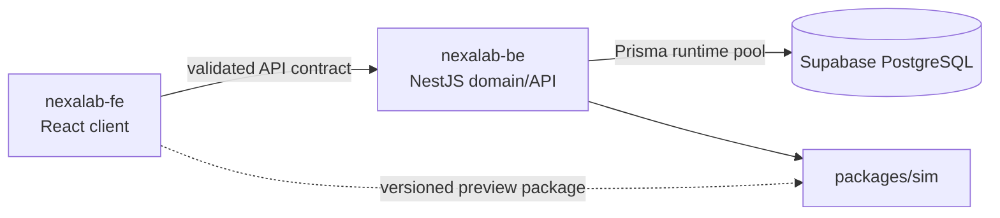
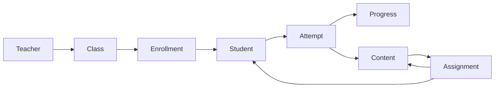

# Architecture Spine — NexaLab Release 1

## Design Paradigm

Use a layered, server-authoritative domain. `nexalab-fe` renders role-specific journeys and provisional interaction state. `nexalab-be` validates commands, enforces identity and ownership, recomputes simulations, and persists official evidence. `packages/sim` is a deterministic shared computation library, not an authority boundary by itself.

## Invariants & Rules

### AD-1 — Repository boundaries [ADOPTED]

- **Binds:** all Release 1 work
- **Prevents:** duplicated authority and a second product-planning source
- **Rule:** `nexalab-be` is the coordination root and owns API, persistence, product planning, and official evaluation. `nexalab-fe` owns client behavior and UX artifacts. BMAD is installed only at the backend root and plans both repositories.

### AD-2 — Role-specific identity and session contract [ADOPTED]

- **Binds:** FR-01, FR-07, FR-16, FR-19, FR-20
- **Prevents:** student self-registration, mixed recovery rules, and client-trusted sessions
- **Rule:** students authenticate with provisioned username credentials; adults authenticate with email credentials. Access tokens are short-lived, refresh sessions are server-recorded and revocable, and temporary-password gating is enforced by the API before protected learning access.
- **Delivery rule:** authentication/session hardening is the first functional prerequisite inside A1. It may use its own coordinated backend/frontend branch, but it must merge before assignment and learning-path work and does not become a separate product epic. Seeded identities are non-production fixtures that traverse the same API/guards; no mock-login or Student registration path is allowed.

### AD-3 — RBAC plus resource ownership [ADOPTED]

- **Binds:** FR-02, FR-03, FR-08, FR-16, FR-17, FR-18, FR-19, FR-20
- **Prevents:** hidden-UI authorization and cross-class or cross-child data access
- **Rule:** every protected route enforces both role and resource relationship. Teacher access is derived from class ownership and approved enrollment; parent access from an explicit parent link; student evidence from the authenticated student identity; admin capability remains explicit rather than implicit bypass.

### AD-4 — Shared identity and learning relationships

- **Binds:** FR-03, FR-04, FR-06, FR-08, FR-14, FR-15
- **Prevents:** role-specific duplicate models and progress without traceable evidence
- **Rule:** preserve `Teacher → Class → Student` through teacher ownership and enrollment. Preserve `Content → Assignment → Attempt → Progress` with stable identifiers and source links; when a stage does not produce an attempt, its completion evidence must still identify the student, assigned content, step, and time.

### AD-5 — API boundary conventions [ADOPTED]

- **Binds:** FR-05 and all cross-repository tickets
- **Prevents:** divergent validation, ambiguous errors, and UI assumptions that bypass the server
- **Rule:** validate request bodies with Zod at backend routes; use authenticated actor identity rather than client-supplied ownership; return stable JSON success payloads and recoverable error responses; use ISO-8601 UTC timestamps and opaque string IDs. Contract changes must update backend tests and frontend consumers in the same vertical ticket.

### AD-6 — Server-authoritative learning gates and progress

- **Binds:** FR-08, FR-11, FR-12, FR-15
- **Prevents:** unlocking content or awarding progress through client state alone
- **Rule:** the backend determines assignment applicability, quiz outcome, unlocked step, and official progress. The client may render optimistic or preview state only when it is visibly provisional and reconciles with the next server response.

### AD-7 — Simulation and verdict authority [ADOPTED]

- **Binds:** FR-13, FR-14, QR-01
- **Prevents:** client or AI alteration of scientific result and verdict
- **Rule:** the client submits lab state; the backend recomputes via the deterministic engine and persists that result with the evaluator verdict. AI and frontend previews never become official evidence.

### AD-8 — Versioned shared simulation package [ADOPTED]

- **Binds:** every lab and challenge
- **Prevents:** silent frontend/backend model drift
- **Rule:** keep `packages/sim` deterministic with unit tests. When the frontend consumes it, publish or pack a versioned artifact and record the version at both consumers; official execution still occurs on the backend.

### AD-9 — Evidence-tiered verification

- **Binds:** every Release 1 ticket and release claim
- **Prevents:** source presence or mock behavior being reported as runtime or production success
- **Rule:** report source verification, automated tests, runtime verification, and production verification separately. Integration/E2E passes only with its real PostgreSQL, seeded API, configured frontend, and browser dependencies running.

### AD-10 — Supabase is the MVP PostgreSQL provider, not a second application backend [ADOPTED]

- **Binds:** all persisted Release 1 capabilities
- **Prevents:** browser database credentials, split auth authority, migration drift, and connection exhaustion
- **Rule:** Prisma 6.19 remains the schema/migration/query boundary and Supabase supplies managed PostgreSQL only. For the current long-lived NestJS service, `DATABASE_URL` uses the Supabase **Session pooler** copied from the Connect panel; `DIRECT_URL` uses the direct database URI for Prisma migrations, seed, introspection, and admin tooling, or the Session pooler only when the deployment network cannot reach the direct IPv6 endpoint. A future serverless deployment may adopt the Transaction pooler only through a reviewed architecture change with Prisma/PgBouncer compatibility tests. Both URLs require SSL, are server-only secrets, and are never constructed from guessed region/host values. NestJS keeps authentication/session/RBAC/ownership authority; Supabase Auth, direct browser queries, and RLS are out of MVP scope.
- **Environment gate:** use isolated development/test, staging/pilot, and production projects or databases; never run `prisma migrate dev`, destructive reset, or seed against pilot/production. Deployment uses reviewed migrations through `prisma migrate deploy`, followed by a smoke query and schema/version check. Backup/PITR claims require the selected plan and a witnessed restore rehearsal.

#### MVP Supabase configuration checklist

1. Create separate non-production and pilot projects in the closest approved region; production remains separate. Record project ref, region, owner, environment, and intended data classification outside Git.
2. In Database settings, enable SSL enforcement. Copy the full Session pooler and direct URIs from **Connect**; percent-encode reserved password characters. Use at least `sslmode=require`; adopt `verify-full` with the downloaded project CA where the deployment runtime supports managed CA configuration.
3. Store `DATABASE_URL` and `DIRECT_URL` only in backend/local secret stores. `.env.example` contains placeholders, never a project ref/password. The frontend receives only `VITE_API_URL`.
4. Configure Prisma 6.19 `datasource db` with runtime `url = env("DATABASE_URL")` and CLI `directUrl = env("DIRECT_URL")`; generate one reusable Prisma client per API process. Tune connection limit only after observing the selected Supabase plan and peak concurrency.
5. Run reviewed migrations with `prisma migrate deploy` through `DIRECT_URL`; run the guarded idempotent seed separately only in an approved non-production target. Do not use `db push`, `migrate dev`, or reset as a deployment step.
6. Smoke-check TLS connection, migration version, seed idempotency, API health, one authorized read/write transaction, connection count/pool behavior, and a deliberate dependency failure. Redact all connection strings from output.
7. Before pilot, confirm the plan's backup capability, run a restore rehearsal into an isolated target, define monitoring/alerts for connection exhaustion, CPU/memory/disk, slow queries and API failure rate, then record actual RPO/RTO. Do not infer backup or production readiness from the dashboard alone.

### AD-11 — Explicit learning-step and evidence model [ADOPTED]

- **Binds:** FR-04, FR-10, FR-11, FR-12, FR-14, FR-15
- **Prevents:** progress inferred from page visits, overwritten quiz history, and gates that exist only in the client
- **Rule:** a published lesson owns ordered `LessonStep` records of validated types `READING`, `VIDEO`, `STUDY_CARDS`, `QUIZ`, `LAB`, or `CHALLENGE`. `StepProgress` records per-student step evidence and high-water progress; every quiz submission creates immutable `QuizAttempt` evidence; every practical submission creates immutable `Attempt` evidence. Aggregate `Progress` is a rebuildable projection updated atomically from these source records, never the sole evidence source.

### AD-12 — Cross-repository contracts and resilient interaction [ADOPTED]

- **Binds:** FR-05 and QR-07 through QR-10
- **Prevents:** frontend/backend payload drift, duplicate mutations, and false success during network failure
- **Rule:** backend Zod schemas and generated OpenAPI are the canonical HTTP contract. A contract-changing vertical ticket updates route schema, OpenAPI snapshot/contract tests, frontend API types/fixtures, and error handling together. Errors use `{ statusCode, code, message, details? }`. Mutations that may be retried use an idempotency key or return a stable conflict; the client may retry safe reads once with bounded backoff but never blindly repeats a non-idempotent mutation. Loading preserves layout, failures preserve recoverable student input, and official success is shown only after the server confirms persistence.

## Consistency Conventions

| Concern | Convention |
| --- | --- |
| Roles and states | Use explicit stable enums or validated string unions at the API boundary; no authorization from display labels. |
| IDs and dates | Opaque string IDs; ISO-8601 UTC at API boundaries; database timestamps remain authoritative. |
| Mutations | Authenticate, authorize ownership, validate, compute authoritative result, persist atomically, then respond. |
| Errors | Distinguish validation, unauthenticated, forbidden, not found, conflict, and dependency/system failure; frontend supplies a recovery action where one exists. |
| Progress evidence | Every displayed metric or state resolves to source content, assignment, quiz result, or attempt. |
| Database connections | Pooled SSL URL for runtime; direct/session SSL URL for Prisma CLI and maintenance; one reusable Prisma client per process. |
| Contract evolution | Backward-compatible within an epic where practical; otherwise version payload fields and update both repos in one vertical ticket. |

## Capability → Architecture Map

| Capability / Area | Lives in | Governed by |
| --- | --- | --- |
| Identity and sessions | `nexalab-be/src/auth.ts`, auth routes, `nexalab-fe/src/api.ts` and auth UI | AD-2, AD-3, AD-5 |
| Classes and assignments | Prisma domain and backend routes; frontend operator/student views | AD-3, AD-4, AD-5 |
| Student learning path | Backend content/progress APIs and frontend Student routes/pages | AD-4, AD-5, AD-6 |
| Labs and attempts | `packages/sim`, backend attempt routes, frontend labs | AD-7, AD-8, AD-9 |
| Parent/Admin envelopes | Backend ownership/admin routes; deferred dedicated UX | AD-2, AD-3, AD-4 |
| Supabase/Prisma operations | Supabase project configuration, Prisma schema/migrations/seed, deployment secret store | AD-9, AD-10 |
| Learning evidence | `LessonStep`, `StepProgress`, `QuizAttempt`, practical `Attempt`, rebuildable `Progress` projection | AD-4, AD-6, AD-11, AD-12 |

## Deferred

- Final application hosting and observability vendor remain open; Supabase PostgreSQL and the database connection/migration boundary are fixed for MVP.
- Paid Supabase plan, final region, production RPO/RTO, and backup/PITR policy must be selected before pilot launch and verified by restore rehearsal.
- Teacher, Parent, and Admin screen architecture waits for their increments; shared identity and ownership invariants do not.
- AI provider and prompt architecture wait for Future scope; no Release 1 contract depends on them.
