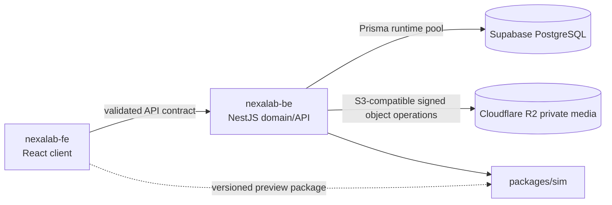
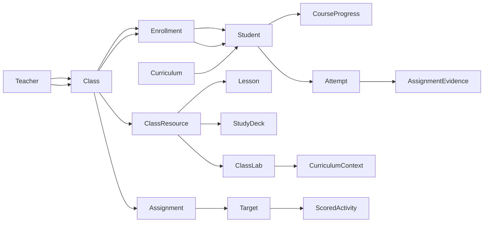

# Architecture Spine — NexaLab Release 1

## Design Paradigm

Use a layered, server-authoritative domain. `nexalab-fe` renders role-specific journeys and provisional interaction state. `nexalab-be` validates commands, enforces identity and ownership, recomputes simulations, and persists official evidence. `packages/sim` is a deterministic shared computation library, not an authority boundary by itself.

## Invariants & Rules

### AD-1 — Repository boundaries [ADOPTED]

- **Binds:** all Release 1 work
- **Prevents:** duplicated authority and a second product-planning source
- **Rule:** `nexalab-be` is the coordination root and owns API, persistence, product planning, and official evaluation. `nexalab-fe` owns client behavior and UX artifacts. BMAD is installed only at the backend root and plans both repositories.

### AD-2 — Role-specific identity and session contract [ADOPTED]

- **Binds:** FR-01, FR-07, FR-16, FR-19, FR-20
- **Prevents:** student self-registration, mixed recovery rules, and client-trusted sessions
- **Rule:** students authenticate with provisioned username credentials; adults authenticate with email credentials. Access tokens are short-lived, refresh sessions are server-recorded and revocable, and temporary-password gating is enforced by the API before protected learning access.
- **Delivery rule:** authentication/session hardening is the first functional prerequisite inside A1. It may use its own coordinated backend/frontend branch, but it must merge before assignment and learning-path work and does not become a separate product epic. Seeded identities are non-production fixtures that traverse the same API/guards; no mock-login or Student registration path is allowed.

### AD-3 — RBAC plus resource ownership [ADOPTED]

- **Binds:** FR-02, FR-03, FR-08, FR-16, FR-17, FR-18, FR-19, FR-20, FR-24
- **Prevents:** hidden-UI authorization and cross-class or cross-child data access
- **Rule:** every protected route enforces both role and resource relationship. Teacher access is derived from class ownership and approved enrollment; parent access from an explicit parent link; student evidence from the authenticated student identity; admin capability remains explicit rather than implicit bypass.

### AD-4 — Separate curriculum, class-resource, and assignment relationships

- **Binds:** FR-03, FR-04, FR-06, FR-08, FR-14, FR-15, FR-24
- **Prevents:** role-specific duplicate models, class resources being forced into assignments, and course progress being conflated with class evidence
- **Rule:** preserve `Teacher → Class → Enrollment → Student`; model released official curriculum and foundational student-progress evidence independently of class membership; model `Class → ClassResource → Lesson/AssetVersion/StudyDeck/StudyQuiz/ClassLab`; model `Class → Assignment → Target → ScoredTest/Exercise/Lab → Attempt/EvaluatedEvidence` only for explicitly assigned work. Study decks and study quizzes are unscored practice. Every evidence record retains stable source/version identifiers and actor/time.

### AD-5 — API boundary conventions [ADOPTED]

- **Binds:** FR-05 and all cross-repository tickets
- **Prevents:** divergent validation, ambiguous errors, and UI assumptions that bypass the server
- **Rule:** validate request bodies with Zod at backend routes; use authenticated actor identity rather than client-supplied ownership; return stable JSON success payloads and recoverable error responses; use ISO-8601 UTC timestamps and opaque string IDs. Contract changes must update backend tests and frontend consumers in the same vertical ticket.

### AD-6 — Server-authoritative access and progress

- **Binds:** FR-08, FR-09, FR-11, FR-12, FR-15
- **Prevents:** unlocking shared content or awarding progress through client state alone, and applying assignment gates to Open Curriculum
- **Rule:** the backend serves released shared curriculum independently of enrollment, assignment, and progress; enforces active, approved membership on Class Space resources; enforces active, approved membership for every Class Space Lab read/launch/write and assignment targets on scored submissions; and calculates official foundational progress from the required items in the fixed course version and determines test outcomes. Keep the official-course denominator fixed. An applicable assigned exercise/test/Lab not achieved keeps the subject achievement summary at “chưa đạt,” while its assignment evidence stays separate from foundational progress. Neither status gates shared content or foundational Labs. The client may render optimistic or preview state only when visibly provisional and reconciled with the next server response.

### AD-7 — Simulation and verdict authority [ADOPTED]

- **Binds:** FR-13, FR-14, QR-01
- **Prevents:** client or AI alteration of scientific result and verdict
- **Rule:** the client submits lab state; the backend recomputes via the deterministic engine and persists that result with the evaluator verdict. AI and frontend previews never become official evidence.

### AD-8 — Versioned shared simulation package [ADOPTED]

- **Binds:** every lab and challenge
- **Prevents:** silent frontend/backend model drift
- **Rule:** keep `packages/sim` deterministic with unit tests. When the frontend consumes it, publish or pack a versioned artifact and record the version at both consumers; official execution still occurs on the backend.

### AD-9 — Evidence-tiered verification

- **Binds:** every Release 1 ticket and release claim
- **Prevents:** source presence or mock behavior being reported as runtime or production success
- **Rule:** report source verification, automated tests, runtime verification, and production verification separately. Integration/E2E passes only with its real PostgreSQL, seeded API, configured frontend, and browser dependencies running.

### AD-10 — Supabase is the MVP PostgreSQL provider, not a second application backend [ADOPTED]

- **Binds:** all persisted Release 1 capabilities
- **Prevents:** browser database credentials, split auth authority, migration drift, and connection exhaustion
- **Rule:** Prisma 6.19 remains the schema/migration/query boundary and Supabase supplies managed PostgreSQL only. For the current long-lived NestJS service, `DATABASE_URL` uses the Supabase **Session pooler** copied from the Connect panel; `DIRECT_URL` uses the direct database URI for Prisma migrations, seed, introspection, and admin tooling, or the Session pooler only when the deployment network cannot reach the direct IPv6 endpoint. A future serverless deployment may adopt the Transaction pooler only through a reviewed architecture change with Prisma/PgBouncer compatibility tests. Both URLs require SSL, are server-only secrets, and are never constructed from guessed region/host values. NestJS keeps authentication/session/RBAC/ownership authority; Supabase Auth, direct browser queries, and RLS are out of MVP scope.
- **Environment gate:** use isolated development/test, staging/pilot, and production projects or databases; never run `prisma migrate dev`, destructive reset, or seed against pilot/production. Deployment uses reviewed migrations through `prisma migrate deploy`, followed by a smoke query and schema/version check. Backup/PITR claims require the selected plan and a witnessed restore rehearsal.

#### MVP Supabase configuration checklist

1. Create separate non-production and pilot projects in the closest approved region; production remains separate. Record project ref, region, owner, environment, and intended data classification outside Git.
2. In Database settings, enable SSL enforcement. Copy the full Session pooler and direct URIs from **Connect**; percent-encode reserved password characters. Use at least `sslmode=require`; adopt `verify-full` with the downloaded project CA where the deployment runtime supports managed CA configuration.
3. Store `DATABASE_URL` and `DIRECT_URL` only in backend/local secret stores. `.env.example` contains placeholders, never a project ref/password. The frontend receives only `VITE_API_URL`.
4. Configure Prisma 6.19 `datasource db` with runtime `url = env("DATABASE_URL")` and CLI `directUrl = env("DIRECT_URL")`; generate one reusable Prisma client per API process. Tune connection limit only after observing the selected Supabase plan and peak concurrency.
5. Run reviewed migrations with `prisma migrate deploy` through `DIRECT_URL`; run the guarded idempotent seed separately only in an approved non-production target. Do not use `db push`, `migrate dev`, or reset as a deployment step.
6. Smoke-check TLS connection, migration version, seed idempotency, API health, one authorized read/write transaction, connection count/pool behavior, and a deliberate dependency failure. Redact all connection strings from output.
7. Before pilot, confirm the plan's backup capability, run a restore rehearsal into an isolated target, define monitoring/alerts for connection exhaustion, CPU/memory/disk, slow queries and API failure rate, then record actual RPO/RTO. Do not infer backup or production readiness from the dashboard alone.

### AD-11 — Explicit curriculum and class-activity evidence model

- **Binds:** FR-04, FR-10, FR-11, FR-12, FR-14, FR-15
- **Prevents:** progress inferred from page visits, overwritten quiz history, public lessons inheriting class-only activities, and gates that exist only in the client
- **Rule:** the released Open Curriculum path contains lesson content, video, lesson-level basic exercises, and an optional foundational Lab when the curriculum version provides one; it contains no Quizlet/study-card or quiz step. Teacher-created study decks and study quizzes are unscored Class Space practice. Scored tests and custom Labs belong to Class Space assignment flow only when explicitly assigned and remain separate from the official curriculum denominator. Reuse immutable attempt/result evidence for scored work. Any legacy step types remain readable for historical assignment evidence but do not automatically place cards/quizzes in the public pathway.

### AD-12 — Cross-repository contracts and resilient interaction [ADOPTED]

- **Binds:** FR-05 and QR-07 through QR-10
- **Prevents:** frontend/backend payload drift, duplicate mutations, and false success during network failure
- **Rule:** backend Zod schemas and generated OpenAPI are the canonical HTTP contract. A contract-changing vertical ticket updates route schema, OpenAPI snapshot/contract tests, frontend API types/fixtures, and error handling together. Errors use `{ statusCode, code, message, details? }`. Mutations that may be retried use an idempotency key or return a stable conflict; the client may retry safe reads once with bounded backoff but never blindly repeats a non-idempotent mutation. Loading preserves layout, failures preserve recoverable student input, and official success is shown only after the server confirms persistence.

### AD-13 — Versioned content and private object storage [ADOPTED]

- **Binds:** FR-10, FR-17, FR-20, QR-08, QR-09
- **Prevents:** binary media in PostgreSQL, production content delivered through development seed, public-bucket authorization bypass, mutable published assets, and incompatible teacher/admin asset ownership.
- **Rule:** Supabase PostgreSQL stores content, source, ownership, review, release and object metadata; private Cloudflare R2 stores binary media. Backend APIs or approved jobs mint short-lived object access after authorization; clients never receive R2 credentials. Assets are explicitly teacher-private or shared-library scoped, while published content pins immutable asset versions. Admin capability is explicit and audited; it may manage shared assets and quarantine/reassign any asset without silently replacing teacher subject review.
- **Delivery rule:** Prisma migration changes schema only; guarded seed creates development/E2E fixtures only; a dry-run-capable versioned Content Release Importer bootstraps or promotes pilot/production packs and assets; runtime authoring and allowlisted connector ingestion use the same validation and provenance contracts. MVP content ingestion is limited to NexaLab-created material and items with verified reusable licenses; public visibility is not a reuse license. Store the exact item-level license, attribution, source locator and checksum. Ingested source items remain staging candidates until editorial/scientific review and publication.

### AD-14 — Topic-bound simulation packs [ADOPTED]

- **Binds:** FR-10, FR-17, FR-20, QR-01, QR-08
- **Prevents:** treating a GLB as simulation logic, hardcoded lab IDs becoming the content model, arbitrary teacher formulas/scripts, visuals drifting from authoritative results, and historical attempts resolving against a newer model or asset.
- **Rule:** a publishable interactive lab must be derived from a versioned learning/practical activity and reviewed scientific model; it pins one immutable topic simulation pack version containing curriculum outcome, activity/model evidence, deterministic simulation model version, teacher-safe parameter schema, challenge template version, visual asset version, semantic node map, declarative visual binding manifest, limitations, accessibility fallback, provenance and golden cases. Scientific expected outputs and golden cases are verified before visual QA. The backend resolves model/version from an allowlisted registry and computes the official result; GLB, materials and animations render that state but never decide the verdict. Published attempts retain the exact pack/model/config versions needed to explain historical evidence.
- **Authoring rule:** the product has two future authoring tracks: a curriculum Lab builder for released, shared packs and a teacher-custom Lab builder linked to a Class Space lesson. This sprint does not implement either builder. Both must respect the reviewed, versioned pack/runtime and immutable-attempt boundaries above, but whether they share editor components or workflows is a research decision, not settled here. A custom GLB may be ordinary lesson media after technical/license validation; it becomes a scored Lab asset only after activity/model review, semantic mapping, model compatibility validation, golden cases and subject-matter approval. Admin manages taxonomy, availability, provenance, technical validation and shared scope without creating scientific attestation.
- **Accuracy gate:** every published scientific claim has source evidence; important facts, formulas, answer keys and models require at least two independent references, including one appropriate authoritative scientific/educational source. Named subject-matter review and rights review are mandatory release gates. Curriculum defines scope/outcomes and is not by itself proof of every scientific claim; passing automated checks alone never authorizes publication.

## Consistency Conventions

| Concern | Convention |
| --- | --- |
| Roles and states | Use explicit stable enums or validated string unions at the API boundary; no authorization from display labels. |
| IDs and dates | Opaque string IDs; ISO-8601 UTC at API boundaries; database timestamps remain authoritative. |
| Mutations | Authenticate, authorize ownership, validate, compute authoritative result, persist atomically, then respond. |
| Errors | Distinguish validation, unauthenticated, forbidden, not found, conflict, and dependency/system failure; frontend supplies a recovery action where one exists. |
| Progress evidence | Every displayed metric or state resolves to source content, assignment, quiz result, or attempt. |
| Database connections | Pooled SSL URL for runtime; direct/session SSL URL for Prisma CLI and maintenance; one reusable Prisma client per process. |
| Contract evolution | Backward-compatible within an epic where practical; otherwise version payload fields and update both repos in one vertical ticket. |

## Capability → Architecture Map

| Capability / Area | Lives in | Governed by |
| --- | --- | --- |
| Identity and sessions | `nexalab-be/src/auth.ts`, auth routes, `nexalab-fe/src/api.ts` and auth UI | AD-2, AD-3, AD-5 |
| Classes and assignments | Prisma domain and backend routes; frontend operator/student views | AD-3, AD-4, AD-5 |
| Student learning path | Backend content/progress APIs and frontend Student routes/pages | AD-4, AD-5, AD-6 |
| Open Curriculum and Class Space | Released curriculum catalog/progress; membership-scoped class resources; class lessons/decks/custom Labs; assignment-target-scoped scored work | AD-3, AD-4, AD-5, AD-6, AD-11, AD-12, AD-13, AD-14, AD-15, AD-16 |
| Labs and attempts | `packages/sim`, allowlisted model registry, versioned topic simulation packs, backend attempt routes, frontend labs | AD-7, AD-8, AD-9, AD-14 |
| Parent/Admin envelopes | Backend ownership/admin routes; assignment-overdue notice for explicitly linked/approved children; other dedicated UX deferred | AD-2, AD-3, AD-4, AD-16 |
| Supabase/Prisma operations | Supabase project configuration, Prisma schema/migrations/seed, deployment secret store | AD-9, AD-10 |
| Content/media releases | Content Release Importer and source connectors in backend jobs; metadata in Supabase; immutable binary versions in private R2 | AD-3, AD-5, AD-9, AD-10, AD-12, AD-13, AD-14 |
| Learning evidence | `LessonStep`, `StepProgress`, `QuizAttempt`, practical `Attempt`, rebuildable `Progress` projection | AD-4, AD-6, AD-11, AD-12 |

## Deferred

- Final application hosting and observability vendor remain open; Supabase PostgreSQL and the database connection/migration boundary are fixed for MVP.
- Paid Supabase plan, final region, production RPO/RTO, and backup/PITR policy must be selected before pilot launch and verified by restore rehearsal.
- Teacher, Parent, and Admin screen architecture waits for their increments; shared identity and ownership invariants do not.
- Exact R2 bucket names, signed-URL TTLs, media size limits, connector schedules, and source-specific parsers are epic/spec configuration under AD-13 rather than initiative-level architecture decisions.
- AI-generated Class Space content is deferred to a later sprint. Provider, prompt/output schema, safety/evaluation, failure/fallback behavior, and AI-generated content UX are outside this change. The general-purpose AI assistant remains a future capability. Student hints are no longer deferred: see AD-18 (increment SAI, PO approval 2026-11-08); free-text tutoring (SAI-04) stays deferred behind gates SG-2 and SG-4.
- Full Teacher and Parent product UX remain deferred; only the assignment lifecycle surfaces for Teacher and explicitly linked/approved Parent are included in this change.

### AD-15 — Class Space authoring, late-test deadlines, and class-only Labs

- **Binds:** FR-11, FR-13, FR-17, FR-24
- **Prevents:** partial/unvalidated imports, mutable attempt history, deadline changes that silently alter recipients, and custom-Lab access through guessed IDs or stale links.
- **Rule:** direct authoring and validated structured-file import create teacher-owned drafts; file import is limited to decks, study quizzes, and tests, with confirmation persisting atomically. Lab creation uses a separate guided 3D authoring workflow, not generic file import. Assigned-test deadlines and late decisions are server-authoritative. Rejection records zero for the late submission; expiry without submission does not auto-score zero. Approval revises the due date of the same assignment for all its assigned recipients in its owning Class Space and records an immutable deadline revision. Every custom-Lab operation checks active, approved membership in the owning class; scored writes additionally check the assignment target snapshot. Details live in `../../specs/spec-open-learning-catalog/class-space-assignment-contract.md`. AI generation is excluded from this delivery.

### AD-18 — Student AI is an advisory, versioned hint layer

- **Binds:** FR-22, BR-06, BR-09, BR-11, BR-13 (SRS UC-AI-01..04, 08, 09)
- **Prevents:** AI changing official results, hints that skip levels without a real retry, untraceable or unreplayable hint text, student data sent to a provider that trains on it, and misconception labels shown to students or parents.
- **Rule:** hint code writes only `HintLog` (and the existing `lastHintLevel` projection); it never writes verdict, score, simulation result, assignment status or progress. Every hint is built from versioned rules (`tutor-rules@n`, `checkpoint-hints@n`, `lesson-hints@n`) and logs its rule version, decision inputs and provider, so the rule part can be replayed. Levels follow Question → Concept → Action → Explanation and rise only after a changed answer. A provider may only prepend one guarded Socratic question at levels 3–4, behind the `STUDENT_AI_LLM_ENABLED` kill switch, with an allowlisted payload, a per-student budget and a cache keyed without student data; it stays off in production until gate SG-2 closes. Students never receive free-text answers (SAI-04 is deferred). Misconception hypotheses are teacher-only; parents see hint counts only. Specs: `../../specs/spec-student-ai-tutor/`, `spec-student-ai-checkpoint-hints/`, `spec-student-ai-lesson-hints/`, `spec-student-ai-teacher-insight/`, `spec-student-ai-what-if/`.

### AD-16 — Cross-role assignment status and notifications

- **Binds:** FR-08, FR-15, FR-17, FR-18, FR-25
- **Prevents:** conflicting deadline/status displays, unauthorized parent visibility, automatic zero scoring at expiry, and notifications sent from stale client state.
- **Rule:** the backend derives assignment status, deadline revisions, recipient eligibility, and notification events from assignment/attempt state. Student surfaces include due-soon and overdue states; teacher surfaces include upcoming/overdue recipients and late-review decisions; parent surfaces may notify only explicitly linked/approved parents about their child's overdue unsubmitted work and remain read-only. Parent notices expose no answers or teacher-only decision controls. Generate/deliver notification events idempotently and retain the in-app channel unless another channel is approved. Reminder timing/cadence is an epic-level policy decision.
