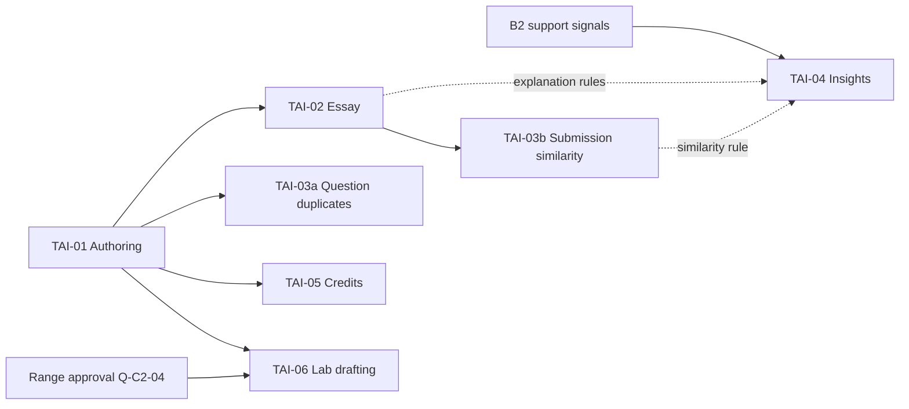

## Completion status (2026-11-09)

The implementation stories remain marked `done`, but the overall increment is in progress because the TAI-06 Pilot student attempt is blocked by an active pack/config mismatch. This is not release approval:

- **Gates:** G-1 and G-5 are closed by the PO. G-2, G-3, G-4 and G-6 are closed on 2026-11-09 **by team-lead decision**, each on a stated assumption, and still need PO, lecturer, legal or reviewer confirmation before go-live. They are not approvals.
  - G-2: PII scrubbing/anonymization (only submission text and rubric reach the provider, student identifiers never do) plus the 3-layer privacy architecture.
  - G-3: baseline token-to-credit rate, configurable by env and PricingVersion rows; to be updated after one month of measured usage.
  - G-4: default safe bounds from the existing `CHALLENGE_PARAMETERS`; `rangeReview` is `team-lead-default`, not `approved`.
  - G-6: the project's existing provider port with the fake provider for golden evaluation and e2e.
- **Evidence:** BE tsc clean, vitest 1077 passed with 4 known unrelated failures, 231 routes; FE tsc and build clean, regression 64/64, all bundle checks pass. Golden and shadow results come from SYNTHETIC sets.
- **Pilot verification 2026-11-09:** all three new migrations applied; TAI-04 90/90, TAI-03 62/62 and TAI-02 31/31 passed with fixture cleanup. Credits PostgreSQL constraints, triggers, advisory lock and debit concurrency passed with rollback/deleted probes. TAI-06 reached student attempt, which returned 409 `SIM_PACK_CONFIG_INCOMPATIBLE` for the active Pilot circuit tuple. No live-provider run, lecturer golden labels or real shadow data.
- **Before go-live:** resolve the active circuit pack/config mismatch and pass the full TAI-06 journey; run the full TAI-05 fault-injection script on a disposable DB; confirm the four gates, collect lecturer labels and one month of token usage.

# TAI / Teacher AI Increment: Suggestion Layer for Authoring, Assessment and Evidence

## Agent handoff

Read these before coding, in this order:
1. `docs/product/prd.md` (FR-21, FR-22, NFR-07)
2. `_bmad-output/planning-artifacts/architecture-spine-nexalab-release-1/ARCHITECTURE-SPINE.md`
3. This increment
4. The epic's spec folder: `SPEC.md`, then every file listed in its `companions:`

The shared runtime contract for every epic is `../specs/spec-teacher-ai-authoring/job-runtime-and-failure-modes.md`. If a rule conflicts or a readiness gate below is unresolved, stop and report it. Do not invent a product decision.

Delegate one ticket per task. Use `$bmad-build` and implement only that ticket as a vertical BE/FE/API/schema slice. Keep NestJS/Zod/OpenAPI and FE types/UI aligned. Enforce authorization in the backend. Follow ticket dependencies. Do not commit or push unless requested. At the end of each session, update `sprint-status.yaml` (`development_status` and `teacher_ai_tracking.story_notes`).

**Copy/paste:**

> Use `$bmad-build` to implement only ticket **[ID and title]** from `increment-tai-teacher-ai.md`. Read this file, the epic's `SPEC.md` and its companions first. Check the ticket dependencies and the epic's readiness gate. Preserve its acceptance criteria and existing product decisions. Do not extend into another ticket or guess unresolved rules. Implement the smallest complete vertical slice. Run relevant checks and report changed files, behavior/API/schema/UI, checks and results, and any blocker. Update `sprint-status.yaml`. Do not commit or push unless requested.

## Feature map

| Epic | Spec folder | Delivers | Depends on | Readiness gate |
| --- | --- | --- | --- | --- |
| TAI-01 Authoring | `../specs/spec-teacher-ai-authoring/` | AI job runtime; grounded DECK/STUDY_QUIZ/TEST drafts; per-item review; duplicate warnings; quota | I2 Class Space resources | G-1, G-6 |
| TAI-02 Essay assessment | `../specs/spec-teacher-ai-essay-assessment/` | Written-task resource, rubric, AI criterion suggestions, teacher final score | TAI-01, I3 | G-1, G-2 |
| TAI-03 Similarity | `../specs/spec-teacher-ai-similarity/` | Cross-class question duplicates; in-assignment submission similarity | TAI-01 (part a), TAI-02 (part b) | G-1 |
| TAI-04 Evidence insights | `../specs/spec-teacher-ai-evidence-insights/` | Versioned rule-based consistency insights on top of B2 signals | B2; TAI-02/03 for some rules | G-1, G-5 |
| TAI-05 AI credits | `../specs/spec-teacher-ai-credits/` | Credit ledger, pricing versions, reserve/settle/refund per job | TAI-01 | G-1, G-3 |
| TAI-06 Lab drafting | `../specs/spec-teacher-ai-lab-drafting/` | AI-proposed challenge variant (allowlisted lab + in-range parameters) on a draft lesson, checked by the engine | TAI-01 | G-1, G-4, G-6 |

## Readiness gates

| Gate | Decision required | Owner | Blocks |
| --- | --- | --- | --- |
| G-1 | **Closed 2026-10-30** (synced to fl05 2026-11-05): FR-21 activated, PRD §10 item 17 and the ARCHITECTURE-SPINE Deferred bullet amended, AD-17 added (ticket TAI-T0) | Product owner / supervising lecturer | — |
| G-2 | Provider terms explicitly permit use in NexaLab's under-18 context; data-use/DPA terms, current-law basis, age-specific notices/consents as applicable, redaction limits, cross-border transfer and retention/deletion approved. Review Law 91/2025/QH15, Decree 356/2025/NĐ-CP and Decree 330/2026/NĐ-CP. Gemini free tier is excluded for student text; paid tier alone does not clear age eligibility. | Product owner / legal reviewer | TAI-02 suggestions; TAI-04 explanation rules. **Closed 2026-11-09 by team-lead decision (PII scrubbing assumption), pending legal/lecturer confirmation; not an approval.** |
| G-3 | At least one month of measured TAI-01 token usage to set `PricingVersion` | Product owner | TAI-05. **Closed 2026-11-09 by team-lead decision (baseline token-to-credit rate, configurable), pending one month of measured usage; not an approval.** |
| G-4 | PO accepts TAI-06 v1 as challenge variants on existing labs (no custom Lab builder); a named reviewer approves `CHALLENGE_PARAMETERS` ranges (Q-C2-04) for `circuit`, `chemistry`, `eye` | Product owner / reviewer | TAI-06. **Closed 2026-11-09 by team-lead decision (default bounds from `CHALLENGE_PARAMETERS`, `rangeReview` = team-lead-default), pending PO and reviewer confirmation; not an approval.** |
| G-5 | PO approves the `insights@1` thresholds and whether `SUDDEN_UNAIDED_PASS` is shown in the pilot | Product owner / supervising lecturer | TAI-04 |
| G-6 | Provider explicitly permits use inside NexaLab's under-18 context; lesson/instruction data boundaries, licensed-source processing rights, transfer, retention and deletion are approved. If Gemini is retained, record written interpretation of its under-18 terms; otherwise select a permitted provider. | Product owner / legal reviewer / curriculum owner | TAI-01 and TAI-06 provider calls. **Closed 2026-11-09 by team-lead decision (existing provider port, fake provider for golden eval and e2e), to be confirmed by PO/lecturer before go-live; not an approval.** |

Prior design choice (not current provider approval; see `.memlog.md` of TAI-01): Gemini API with model id in `GEMINI_MODEL`. No tier is approved until G-6; until then TAI-01 T1–T5 and TAI-06 run only against the fake provider. Revalidate against the current under-18 eligibility terms before any integration. The golden reviewer is the supervising lecturer; TAI-01 quota and quality thresholds are specified.

## Cross-cutting invariants

- AI output is a suggestion. Published content, score, verdict, progress and teacher decisions change only through an authenticated human action with audit.
- Every AI output or derived output pins its input snapshot, prompt version, output-schema version and algorithm/model version, so it can be replayed.
- No provider call runs inside a database transaction. All AI work runs through the TAI-01 job runtime.
- The system never draws conclusions about cheating, "true ability" or student ranking. Insights and similarity are evidence for teacher review only.
- A missing or not-owned class returns the same 403 `CLASS_ACCESS_DENIED` as every existing Class Space route (`ownedClass`); missing rows inside an owned class return 404; an inaccessible lesson returns 400 `LESSON_NOT_AVAILABLE`. Students and parents never see AI suggestions, similarity or insights about other students.
- `AiJob` quota is counted per actor and per `purpose`, and the create body is a `.strict()` discriminated union on `purpose`, from TAI-T2 on.
- Student data is never sent until the provider is approved for this under-18 product context, the legal basis and age-specific safeguards are documented, and data-use, cross-border, retention and deletion terms are approved. A paid tier by itself is insufficient.

## Increment order

TAI-01 runs T0 → T1 → T2 → T3 → T4. T5 (FE) can start once the T2/T4 API contract is frozen. T6 closes the epic. After TAI-01 is done, TAI-03 part (a), TAI-04 first-wave rules and TAI-02 (after G-2) can proceed in parallel with separate file ownership. TAI-05 waits for G-3, and TAI-06 waits for G-4. TAI-04 wave 1 needs no provider and can start as soon as G-1 and G-5 are decided, even before TAI-01 is done.

---

## Epic TAI-01: Teacher AI Drafts Grounded Class Space Content

**Spec:** `../specs/spec-teacher-ai-authoring/SPEC.md`. **FRs:** FR-21, FR-11 (authoring path), FR-03 (ownership).

### Story TAI-T0: Activate FR-21 scope

As a product owner, I want the PRD and architecture to state that Teacher AI drafting is in scope, so that implementation does not contradict approved documents.

**Implements:** gate G-1. **Dependencies:** none.

**Acceptance Criteria:**
**Given** the product owner approves FR-21 activation, **when** PRD §10 item 17 and the ARCHITECTURE-SPINE Deferred bullet are amended and AD-17 is added, **then** no approved document excludes AI drafting, and the approval is recorded in the TAI-01 `.memlog.md`.

### Story TAI-T1: AI module, provider port and prompt versioning

As a developer, I want a provider-agnostic AI module with a Gemini adapter, a fake adapter and versioned prompts, so that every AI job is reproducible and testable without network.

**Implements:** CAP-2, CAP-6 (config). **Dependencies:** TAI-T0.

**Acceptance Criteria:**
**Given** the Gemini adapter, **when** the provider returns 200, 429, 5xx, abort, blocked/empty or another 4xx, **then** the adapter maps each case to the documented failure code.
**Given** `AI_PROVIDER=fake` and `APP_ENV=production`, **when** the API boots, **then** boot fails.
**Given** prompt template text changes without a version bump, **when** tests run, **then** the pinned-digest test fails.
**And** `labs/infrastructure/llm.ts` and the tutor hint tests are unchanged and pass.

### Story TAI-T2: Job schema, create/list/get/cancel and runner

As a teacher, I want to request a draft and follow its progress, so that slow AI calls never block or duplicate my work.

**Implements:** CAP-1, CAP-2, CAP-6. **Dependencies:** TAI-T1.

**Acceptance Criteria:**
**Given** an owner teacher of an active class and an accessible lesson, **when** they `POST /classes/:id/ai-jobs` with an `Idempotency-Key`, **then** one `PENDING` job is returned with 202, and replaying the same key and body returns the same job.
**Given** the outsider teacher or an unknown class, a student, an inaccessible lesson, an archived class, a missing key, a reused key with a different body, or a missing provider, **when** they create a job, **then** the API returns 403 `CLASS_ACCESS_DENIED`, 403, 400 `LESSON_NOT_AVAILABLE`, 409, 400, 409 or 503 respectively and creates no job.
**Given** a teacher with 20 jobs in 24 h or 2 active jobs, **when** they create another (including two concurrent requests at the limit), **then** exactly the over-limit requests return 429 `AI_QUOTA_EXCEEDED`.
**Given** a running job, **when** the teacher cancels, the lease expires, or a reclaimed run persists late, **then** the state machine in `job-runtime-and-failure-modes.md` holds and items are written at most once.

### Story TAI-T3: Output parsing and validation pipeline

As a teacher, I want only structurally valid, grounded and safe items shown to me, with warnings on risky ones, so that review time goes to content judgment rather than format errors.

**Implements:** CAP-3, CAP-4. **Dependencies:** TAI-T2.

**Acceptance Criteria:**
**Given** provider output, **when** it fails the `resource-items@1` schema, **then** the attempt fails as `OUTPUT_SCHEMA_INVALID` and is retried once.
**Given** parsed items, **when** each VR rule fails, **then** the item is dropped with its reason code. Zero surviving items fails the job with `OUTPUT_VALIDATION_FAILED`.
**Given** an item whose normalized prompt equals an existing class question, or whose trigram Jaccard is 0.85 versus 0.84, **when** validated, **then** it is flagged `EXACT_DUPLICATE`, `NEAR_DUPLICATE` or not flagged, exactly per `validation-rules.md`.

### Story TAI-T4: Item decisions and materialization

As a teacher, I want to accept, edit or reject each item and turn the accepted ones into a normal draft, so that AI content enters my class only through the existing publish flow.

**Implements:** CAP-4, CAP-5. **Dependencies:** TAI-T3.

**Acceptance Criteria:**
**Given** a succeeded job with exact or near duplicate flags, **when** the teacher reviews the items, **then** warnings and source references are visible and the teacher can accept, edit or reject each item.
**Given** undecided items or zero accepted items, **when** the teacher materializes, **then** the API returns 409 `AI_REVIEW_INCOMPLETE`.
**Given** all items decided, **when** the teacher materializes, **then** one `ClassResource` DRAFT is created through `normalizeResourceContent`, linked by `materializedResourceId`, and invisible to students until published. A second materialization returns 409, and the same key replays.
**And** TEST keeps the answer key, STUDY_QUIZ drops it, and non-AI resources are unaffected.

### Story TAI-T5: Teacher AI workspace (FE)

As a teacher, I want one panel to generate, review and materialize AI drafts, so that the workflow fits inside my Class Space.

**Implements:** CAP-1..CAP-6 (UI). **Dependencies:** TAI-T2 and TAI-T4 API contract frozen.

**Acceptance Criteria:**
**Given** the owned Class Space resources view, **when** the teacher generates, waits, reviews and materializes, **then** quota, loading, still-processing, failed, cancelled, duplicate-warning and stale-lesson states render, and decisions persist across reload.
**And** no student or parent route renders AI data.

### Story TAI-T6: Golden evaluation and end-to-end proof

As the supervising lecturer, I want measured evidence of answer correctness, so that AI drafting is released only when it is good enough.

**Implements:** success signal. **Dependencies:** TAI-T1..T5.

**Acceptance Criteria:**
**Given** at least 60 TEST items generated from `lesson-circuit`, `lesson-chemistry` and `lesson-eye` with the pinned prompt, **when** the lecturer labels them, **then** answer-key error ≤ 3%, scientific-accuracy error ≤ 5%, and accept or accept-after-edit ≥ 70%, recorded in `tai-01-golden-evaluation.md`.
**Given** seeded fixtures, **when** the SPEC success-signal journey runs against a real API/database, **then** it passes with the outsider, student and replay negatives, and per-job token usage is documented for TAI-05.

---

From TAI-02 on, each epic lists its stories as a table. The acceptance criteria are canonical in that spec's `tickets.md` (**Accept when:**). Copy them into the `$bmad-build` prompt; never paraphrase them.

## Epic TAI-02: Essay Rubric Assessment with AI Suggestions

**Spec:** `../specs/spec-teacher-ai-essay-assessment/SPEC.md`. **Gate:** G-1, plus G-2 for T4..T7 (TAI2-T0 records it). T1..T3 deliver written tasks with manual grading and are not blocked by G-2. **Watch:** TAI2-T2 makes `AssignmentSubmission.score`/`correctCount` nullable, protected by a DB CHECK for auto-scored tests; `test:i3` must pass unchanged.

| Story | Title | Goal (who / what) | Depends on |
| --- | --- | --- | --- |
| TAI2-T0 | Provider, legal and scope gate (documentation and config) | PO and legal reviewer record gate G-2: provider eligibility for the under-18 context with approved data-use/DPA terms, legal basis under Law 91/2025/QH15, Decree 356/2025/NĐ-CP and Decree 330/2026/NĐ-CP, age-specific notice/consent where the approved path requires it, minimization, cross-border transfer, retention/deletion; PRD/AD amendment; `AI_ASSESSMENT_ENABLED`/`AI_ASSESSMENT_MODE` flags. A paid tier alone is not eligibility | — (blocks T4..T7) |
| TAI2-T1 | WRITTEN_TASK kind and rubric content contract | Teacher authors a written task with a versioned rubric | TAI-T0 |
| TAI2-T2 | Assign and submit written tasks | Student submits under existing deadline/late rules | TAI2-T1 |
| TAI2-T3 | Teacher rubric grading and role views | Teacher grades per criterion; student/parent see status | TAI2-T2 |
| TAI2-T4 | ASSESS_SUBMISSION job purpose | Policy-eligible, minimized submission becomes a verified AI suggestion; consent is enforced where required by the approved legal path | TAI2-T0, TAI2-T3, TAI-01 done |
| TAI2-T5 | Shadow mode and evaluation report | Lecturer compares hidden AI suggestions with blind grades on ≥ 100 responses | TAI2-T4 |
| TAI2-T6 | Assisted grading | Teacher accepts, edits or rejects suggestions; AI never writes the grade | TAI2-T5 pass |
| TAI2-T7 | End-to-end journey and negatives | Real journey plus outsider, injection, non-consent and outage probes | TAI2-T6 |

## Epic TAI-03: Question and Submission Similarity

**Spec:** `../specs/spec-teacher-ai-similarity/SPEC.md`. **Gate:** G-1 only. Everything runs on the server and nothing goes to a provider. Part A (T1–T2) ships right after TAI-01. Part B (T3–T5) waits for TAI2-T2.

| Story | Title | Goal (who / what) | Depends on |
| --- | --- | --- | --- |
| TAI3-T1 | Question fingerprint store and backfill | Fingerprints stay consistent with the resource lifecycle | TAI-T3 |
| TAI3-T2 | Cross-class duplicate warnings | Teacher is warned about copies in their other classes and the library, never about other teachers' content | TAI3-T1, TAI-T4 |
| TAI3-T3 | `subsim@1` similarity engine | Deterministic, versioned pairwise similarity with exclusions | TAI2-T2 |
| TAI3-T4 | Similarity runs and review API | Replayable runs with append-only teacher review; no score change | TAI3-T3 |
| TAI3-T5 | Teacher similarity review UI | Side-by-side spans with neutral wording | TAI3-T4, TAI2-T3 |
| TAI3-T6 | End-to-end journey and negatives | Both parts on seeded fixtures with an outsider probe | TAI3-T2, TAI3-T5 |

## Epic TAI-04: Learning Evidence Consistency Insights

**Spec:** `../specs/spec-teacher-ai-evidence-insights/SPEC.md`. **Gate:** G-1, G-5. Rule-based code evaluated on read, with no provider and no AI job. Wave 1 (`insights@1`) depends only on B2. Wave 2 (`insights@2`) waits for TAI-02 and TAI-03.

| Story | Title | Goal (who / what) | Depends on |
| --- | --- | --- | --- |
| TAI4-T1 | Insight rule engine `insights@1` | Versioned rules with exact thresholds and boundary fixtures | B2 (done), G-5 |
| TAI4-T2 | Evidence loader and insight read routes | Owner teacher reads class/student insights with evidence IDs | TAI4-T1 |
| TAI4-T3 | Acknowledgements and replay | Append-only acknowledge/dismiss; replay by `ruleVersion` | TAI4-T2 |
| TAI4-T4 | Teacher insight UX | Neutral insight cards that drill into B2 evidence | TAI4-T2, TAI4-T3 |
| TAI4-T5 | Explanation-mismatch rules (`insights@2`) | Rules read teacher-final written grades only | TAI-02 done, TAI4-T3 |
| TAI4-T6 | Similarity-backed insight | `SUBMISSION_SIMILARITY_HIGH` from reviewed similarity runs | TAI-03 part B done, TAI4-T3 |
| TAI4-T7 | Journey, privacy and performance proof | Students/parents never see insights; latency recorded | TAI4-T4 |

## Epic TAI-05: AI Credits and Usage Ledger

**Spec:** `../specs/spec-teacher-ai-credits/SPEC.md`. **Gate:** G-1, G-3. Credits add to the TAI-01 quota; they do not replace it. With `AI_CREDITS_ENABLED=false`, TAI-01 behaves exactly as specified. Admin grants only; a payment gateway is a non-goal.

| Story | Title | Goal (who / what) | Depends on |
| --- | --- | --- | --- |
| TAI5-T0 | Pricing evidence from TAI-01 usage | Prices derived from one month of measured usage and approved | TAI-T6, G-3 |
| TAI5-T1 | Ledger schema and posting primitives | Immutable ledger; balance never negative | TAI5-T0 |
| TAI5-T2 | Pricing versions and estimate | Versioned price per purpose and job estimate | TAI5-T1 |
| TAI5-T3 | Reserve, settle and refund in the AI job lifecycle | Exactly one reserve and one settle or refund per terminal job | TAI5-T2, TAI-T2 |
| TAI5-T4 | Admin grants and adjustments | Idempotent, audited grants with reasons | TAI5-T1 |
| TAI5-T5 | Teacher credit view and estimate confirmation UX | Teacher confirms estimate and sees credits, never tokens | TAI5-T3 |
| TAI5-T6 | Reconciliation script and failure-injection proof | `credits:reconcile` proves ledger integrity under failures | TAI5-T3, TAI5-T4 |

## Epic TAI-06: AI Lab Challenge Drafting

**Spec:** `../specs/spec-teacher-ai-lab-drafting/SPEC.md`. **Gate:** G-1, G-4. v1 plugs into the existing `Lesson.labId` + `Lesson.challengeParams` contract (`challengeParamErrors`, `CHALLENGE_PARAMETERS`), not a custom Lab builder. Every model is currently `rangeReview: "pending"`, so no proposal can pass until ranges are approved.

| Story | Title | Goal (who / what) | Depends on |
| --- | --- | --- | --- |
| TAI6-T0 | Gates: range approval and v1 scope decision | PO accepts v1 scope; named reviewer approves model ranges | G-4 |
| TAI6-T1 | Extract lesson challenge-variant application function | Apply path reusable from the AI module without a controller import | TAI6-T0 |
| TAI6-T2 | Proposal prompt, output schema and engine validation | Proposals pass ranges and golden engine states | TAI6-T0, TAI-T1, TAI-T3 |
| TAI6-T3 | `DRAFT_LAB_CHALLENGE` job purpose, review and apply routes | Teacher reviews and applies one proposal to a draft lesson | TAI6-T1, TAI6-T2, TAI-T2, TAI-T4 |
| TAI6-T4 | Teacher proposal review UX | Preview by deterministic engine before apply | TAI6-T3 |
| TAI6-T5 | Golden evaluation and end-to-end proof | Lecturer rates ≥ 70% of proposals sensible; journey passes | TAI6-T4 |

## Tracking

- **Status source:** `../implementation-artifacts/sprint-status.yaml`, keys `epic-tai-0N-*` and `tai-0N-tM-*` under `development_status`, plus notes under `teacher_ai_tracking`. Values: `backlog | ready-for-dev | in-progress | review | done`.
- A ticket moves to `ready-for-dev` only when its dependencies are `done` and its epic gate is decided. The gate decision must be appended to that spec's `.memlog.md`.
- `review` means verified on the isolated local runtime and awaiting commit/PR and PO acceptance. `done` needs the ticket's **Accept when:** evidence recorded in `teacher_ai_tracking.story_notes`.
- A spec changes only through its `.memlog.md` followed by re-derivation (bmad-spec). If a change alters a ticket, update this table and `sprint-status.yaml` in the same session.

### Final verification — 2026-11-09

2026-11-09 final verification: sprint-status.yaml parses with js-yaml after escaping apostrophes in evidence notes (including TAI4-T6). tai04-integration.mjs now adds teacher-final EXPLANATION grading and three insights@3 MCQ mismatch, evidence/privacy and replay checks (85 -> 90 on a local run, with the existing local latency check). Static checks passed: node --check, Prisma schema validate, BE build, 68 targeted Vitest tests. Real-DB migration/journey verification remains pending: Docker/Supabase CLI absent; local PostgreSQL 18 is running but postgres login requires a password not configured in this session. No remote Pilot migration/run was attempted because AGENTS.md forbids migration/test against shared Supabase. No live journey pass or DB cleanup is claimed; no new fixture was created. rangeReview remains team-lead-default, shared-library publish stays gated pending reviewer.

### Pilot DB verification — 2026-11-09

2026-11-09 Pilot DB verification under explicit Team Lead override: migrations 20261109120000, 20261109150000, 20261109170000 applied successfully (Prisma migrate status up to date). TAI-04 journey 90/90 checks passed including insights@3; TAI-03 62/62; TAI-02 31/31. TAI-05 PostgreSQL CHECK, append-only triggers, advisory lock contention and concurrent debit boundary passed using rollback/deleted probes; full tai05-integration.mjs was not run because it temporarily disables a trigger/constraint and is restricted to disposable DB. TAI-06 job/review/apply/publish/assign passed, but student attempt returned 409 SIM_PACK_CONFIG_INCOMPATIBLE with the Pilot active circuit pack (lightbulb model versus LED challenge); full TAI-06 DB journey remains open. Cleanup verified baseline users 10, classes 3, assignments 25, resources 7, AiJob 0, CreditAccount 0, and zero prefixed users. Sessions are 109 versus the historical 102; all remaining sessions belong to seeded users and were not deleted. rangeReview stays team-lead-default; shared-library publish still requires reviewer.
