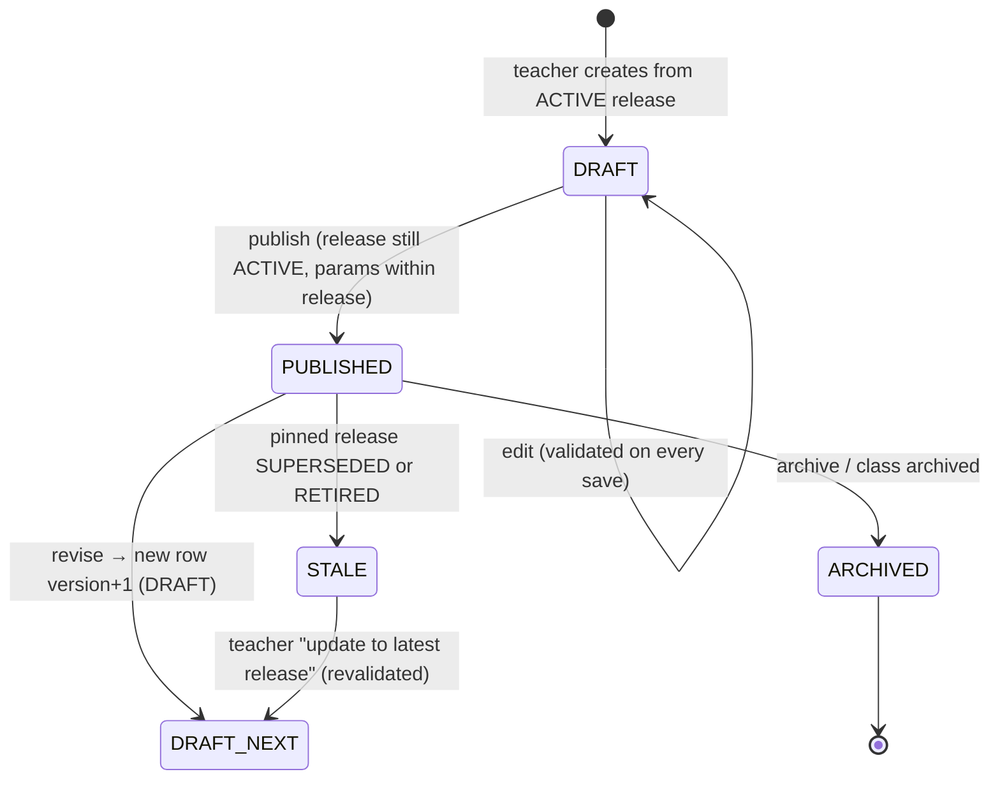

# Class Lab Track (D-LP-01: configuration on an active LabRelease)

## Definition

A Class Lab is a versioned Class Space resource owned by the class-owner teacher. It contains:

```ts
type ClassLabContent = {
  labReleaseId: string;                 // must be ACTIVE when the Class Lab version is published
  challengeTemplateId: string;          // one of release.challengeTemplates
  params: Record<string, number|string>;// each within release.params (number: min/max/step; choice: subset)
  stateConstraints?: Constraint[];      // optional narrowing of release.stateConstraints, never widening
  instructions: string;                 // teacher prompt (≤ 2000 chars, plain text/markdown, no URLs to scripts)
  lessonId: string;                     // class lesson context, required
  taxonomy: { subjectId, grade, chapterCode, topicCode };  // copied from lesson, validated, not editable
};
```

What a teacher **cannot** set: model, equations, constants, units, release state, ranges outside the release, assets, scoring map, verdict normalization, outcome approval.

## Why `ClassResource` kind `LAB` (D-LP-05, proposed)

The existing `ClassResource` already provides what a Class Lab needs, so this reuses it instead of a new table (`brownfield.md` E-16):
- owner-only teacher access and member-only `PUBLISHED` reads (`src/modules/classes/application/class-resources.service.ts:22-46`);
- idempotent create (`:54-59`);
- immutable revisions as new rows with `version + 1` under a lock (`:97-108`);
- a lesson link and status `DRAFT/PUBLISHED/ARCHIVED` (`prisma/schema.prisma:174-193`).

Proposed additive changes:
- add `LAB` to `ClassResourceKind` (`prisma/schema.prisma:33-37`);
- add a content validator for `ClassLabContent`;
- add Attempt context columns (see `data-model-and-api.md`).

`ClassResourcePractice` (unscored latest state, `prisma/schema.prisma:194-205`) can hold the member's last practice workspace. It must never hold verdicts.

## Lifecycle



`STALE` is a derived flag, not a stored status. Existing practice and assignments keep working on the pinned release while it is `ACTIVE` or `SUPERSEDED`. Once the pinned release is `RETIRED` or `QUARANTINED`:
- new launches stop with `CLASS_LAB_UNAVAILABLE`;
- the teacher is notified;
- history remains readable.

## Access and scoring matrix

| Operation | Class-owner teacher | Active approved member | Assignment target | Pending/removed/non-member/other teacher | Parent |
|---|---|---|---|---|---|
| List/detail DRAFT | ✓ | ✗ | ✗ | ✗ (non-enumerating) | ✗ |
| List/detail PUBLISHED | ✓ | ✓ | ✓ | ✗ | ✗ |
| Launch practice (`CLASS_PRACTICE`) | preview only | ✓ unscored | ✓ unscored | ✗ | ✗ |
| Submit practice attempt | ✗ | ✓ recorded, no assignment evidence | ✓ | ✗ | ✗ |
| Launch/submit scored (`ASSIGNMENT`) | ✗ | ✗ unless target | ✓ | ✗ | ✗ |
| Read scored results | ✓ own class | own only | own only | ✗ | linked child, assignment summary only (existing C1 rules) |

Every operation re-checks on the server: class `ACTIVE`, membership `approved` (`applicableAssignmentWhere` / `assertMember` patterns already exist), resource `PUBLISHED` and pinned release launchable.

## Assignment

- New `Assignment.contentType = "class_lab"`. `contentId` = the ClassResource row ID (a version-specific row). `contentVersion` = the ClassLab content digest, which includes `labReleaseId`.
  - Today `contentType` allows `lesson | lab | test` (`src/modules/classes/application/assignments.service.ts:13,35`).
  - Today the lab `contentVersion` hashes only `simulationModelRef + config` (`src/modules/lessons/application/lesson-content.ts:256-261`). That is insufficient, because activating a pack does not change it.
- Targets use the existing immutable `AssignmentTarget` snapshot.
- Scored attempt: context `ASSIGNMENT`, `assignmentId`, `classResourceId` and `labReleaseId` of the Class Lab version.
- Scoring = release scoring map + Class Lab params, evaluated on the server exactly as the foundational path.
- High-water evidence ("later failure never undoes a pass") follows the existing step-progress rule (`src/modules/labs/interface/labs.controller.ts:213-235`).
- Late/deadline rules: reuse the I3 assignment lifecycle for tests where applicable. Labs have no late-decision workflow today, so this is open decision P-5.

## Relation to existing teacher variants

Today a teacher "challenge variant" is a `Challenge` row `${labId}_v-${lessonId}` with `constraints.params`. It is **upserted in place** when the lesson is saved (`src/modules/lessons/interface/lessons.controller.ts:199-207`; `lesson-content.ts:264`). Attempts made earlier keep only the `challengeCheck.params` copy inside `simulationResult`.

Migration proposal:
- Freeze existing variants. Any edit creates a Class Lab (or a new variant ID) instead of updating the row.
- Keep old variant attempts readable as `legacy_unverified`.
- New teacher customisation goes only through Class Lab.
- Teacher-private Lessons that embed a `CHALLENGE` step keep working until the PO decides the retirement window (open decision P-6).

## Boundaries

| Flow | Foundational Lab | Class Lab |
|---|---|---|
| Discovery | Open catalog by topic (students: released only) | Class Space only |
| Access | Any authenticated student | Active approved class members |
| Evidence | `FOUNDATIONAL` / `LESSON_STEP` (assignmentId null) → foundational progress | `CLASS_PRACTICE` (no score evidence) / `ASSIGNMENT` (scored, teacher reports) |
| Course denominator | Yes, if `FoundationalCourseLesson.foundationalLabId` marks it required | Never |
| Science | Release | Same release, narrowed |
| Who changes it | NexaLab release process | Owner teacher (new version) |

## Class Lab acceptance (P3.7 gate)

1. A teacher cannot create a Class Lab on a non-ACTIVE release, nor with params or constraints outside the release. Server tests cover each param kind and boundary.
2. Members/non-members/pending/removed/other-teacher/parent each receive the matrix result on list, detail, launch, submit and result read. Denials are non-enumerating.
3. Revision creates a new version. Earlier assignments and attempts still evaluate and replay on their pinned release.
4. Superseding the release marks the Class Lab stale and keeps existing assignments working within policy. Quarantine blocks new launches.
5. Class Lab attempts never appear in foundational progress or the open catalog.
