# Phase Plan P3.1–P3.7

The P3.1 implementation-plan steps 0–4 were implicit sub-phases. This plan makes them explicit phases with gates. P1 (SGK viewer) and P2 (video evidence) are upstream content phases. P2 has code on `origin/p2-vid` but no spec file. P3.4 needs P2 merged if the pilot runs a "Lesson/video → Lab" path.

| Phase | Goal | Inputs | Outputs | Roles | Starts when | Gate (done when) | Evidence |
|---|---|---|---|---|---|---|---|
| **P3.1 DEFINE** | Decide pipeline, contract, phases | P3.1 spec set (unmerged branch), this spec | ADR-LAB-01 accepted. Contract v1 + fixtures (circuit + mock). Rubric + blueprint template. Updated P3.1 brownfield/memlog. Open decisions with owners | PM (owner), architect, curriculum lead, science lead | now | DEFINE exit list below | Reviewed docs. Fixture JSON files. No code |
| **P3.2 Platform contract v1** | Make versions exact and runs resilient | ADR, contract v1 | LabRelease + receipts schema, launch routes, contract-v1 `POST /attempts`, FE renderer host + registry + draft, release/activate/quarantine API, Open Curriculum LAB step (D-LP-06) | Platform integrator, BE, FE | P3.1 gate | `contract-v1.md` acceptance 1–3 on isolated DB | CI contract + integration runs. Unit/integration test files |
| **P3.3 Outcome Register** | Provenance-backed outcomes and mapping | Authority document (C-1), taxonomy, Content Tool outputs | Register for KHTN 8 Circuit cluster first, then the remaining chapters. Register defects fixed (`lab-catalog-khtn8-9.md` §1). Reviewed P/S/N classification of the 30-candidate catalog (CAT-1). Mapping rows. One pilot outcome with curriculum receipt | Curriculum lead, named reviewer | P3.1 gate (runs ‖ P3.2) | Every Circuit-cluster outcome has a review state. Pilot outcome ACTIVE with receipt. Coverage report counts only ACTIVE | Register export + receipts |
| **P3.4 Pilot LED Circuit** | First real released Foundational Lab | P3.2 gate, P3.3 pilot outcome, approved blueprint | `circuit@1.1.0` (+ fixtures GC-01…GC-15 incl. `SHORT_CIRCUIT`), `circuit-2d` renderer, activity/pack/LabRelease, staging release, one real attempt | Lab team, subject + model reviewers (distinct), QA, release manager | P3.2 + P3.3 gates + blueprint receipts | Real attempt on staging pins and replays the reviewed release. QA matrix pass. Release recorded with receipts | Staging logs, replay report, QA report |
| **P3.5 Second-model gate** | Prove the contract generalises | P3.4 | Fixture-only second model through BE registry **and** FE renderer registry | Platform integrator | P3.4 gate | Mock model passes the same contract suite end to end. Decision to open ≤2 Labs | CI run |
| **P3.6 Lab factory & operations** | Repeatable per-Lab delivery and maintenance | P3.5, catalog | Runbook, monitoring dashboards/queries, update/quarantine/rollback procedures, engine-retention policy. Next Labs (≤2 concurrent) | Release manager, platform, Lab teams | P3.5 gate | Each new Lab passes stages 4–9. One rollback drill on staging | Release records, drill log |
| **P3.7 Class Lab** | Teacher configuration on ACTIVE release (D-LP-01) | ≥1 ACTIVE release (P3.4), P-5/P-6 decisions | ClassResource `LAB`, validator, launch route, `class_lab` assignments, teacher UI, legacy variant freeze | BE, FE, teacher-UX | P3.4 gate (design can start ‖ P3.4) | `class-lab-track.md` acceptance 1–5 | Integration tests for the access matrix, replay of Class Lab attempts |

## Parallel / blocked

```mermaid
gantt
  dateFormat  X
  axisFormat  %s
  section DEFINE
  P3.1 DEFINE                 :d1, 0, 2
  section Parallel after DEFINE
  P3.2 Platform contract v1   :p2, after d1, 4
  P3.3 Outcome Register       :p3, after d1, 4
  P3.7 Class Lab design only  :c0, after d1, 2
  section Gated
  P3.4 Pilot LED              :p4, after p2, 3
  P3.5 Second-model gate      :p5, after p4, 1
  P3.6 Lab factory (≤2 Labs)  :p6, after p5, 4
  P3.7 Class Lab build        :p7, after p4, 3
```

Units are relative ordering, not estimates.

## DEFINE exit (P3.1 gate)

- [ ] ADR-LAB-01 accepted: D-LP-02…D-LP-05 (D-LP-06 needs the PO).
- [ ] `contract-v1.md` reviewed. `fixtures/circuit@1.1.0.json` and `fixtures/mock-slider@1.0.0.json` drafted.
- [ ] P3.1 spec corrected:
  - memlog no-migration line marked superseded;
  - brownfield adds E-02, E-04, E-05, E-07, E-08, E-09, E-10, E-11, E-12, E-15, E-16, E-17 from `brownfield.md`;
  - implementation-plan steps 1–4 point to P3.2–P3.6.
- [ ] Unmerged branch `origin/codex/foundational-lab-platform`: decide to merge the spec commits separately from the pinning fix, and review the fix (it becomes the base for P3.2).
- [ ] Open decisions P-1, P-2, T-1…T-4 decided. All others have an owner and the phase they block.
- [ ] No Lab approval or release is required to exit DEFINE.

## First implementation step after DEFINE

In P3.2, write the **contract-v1 integration tests first** (isolated PostgreSQL, not skipped in CI):
- activation mid-session within/after grace;
- concurrent duplicate submit;
- legacy client window;
- replay of a new attempt;
- legacy attempt label;
- mock second model.

Then add the `LabRelease`/receipt schema and route `POST /attempts` through release resolution.

## Open decisions

| ID | Type | Question | Blocks | Proposed default |
|---|---|---|---|---|
| P-1 | Product | Foundational Lab inside an Open Curriculum Lesson: `LAB` step with `LESSON_STEP` context (D-LP-06) or link-out to the standalone Lab? | P3.2 | `LAB` step, `assignmentId=null` |
| P-2 | Product | Do passes on SUPERSEDED releases keep counting toward foundational progress? | P3.2 | Yes. A new release never removes past progress |
| P-3 | Product | Order relative to the Content Tool "Lab GO after Lesson pilot" (`spec-nexalab-content-tool-mvp/master-plan.md:124`) | P3.4 | Platform (P3.2) may proceed; pilot release waits for the Lesson pilot |
| P-4 | Product | Device matrix and 2D/3D budgets | P3.4 | Budgets in `foundational-lab-track.md` §6 |
| P-5 | Product | Deadlines/late handling for `class_lab` assignments | P3.7 | Due date only, no late decision in v1 |
| P-6 | Product | Retirement window for legacy `_v-` challenge variants | P3.7 | Freeze now, retire after P3.7 ships |
| C-1 | Curriculum | Which official KHTN program document/version is authoritative? | P3.3 | — (must be named) |
| C-2 | Curriculum | Pilot outcome and named curriculum reviewer | P3.4 | Candidate from the B22 cluster |
| C-3 | Curriculum | KHTN 9 provenance standard | KHTN 9 bindings | Same as KHTN 8 |
| S-1 | Scientific | LED polarity vs "pre-oriented" label. 2.0 V drop. 1–20 mA band. Ranges U/R/N/B | P3.4 | — (reviewer) |
| S-2 | Scientific | `SHORT_CIRCUIT` status. Meaning of `partial` on overload | P3.4 | Separate status. Overload = needs_practice with explanation |
| S-3 | Scientific | Named subject and model reviewers, conflict-of-interest rule | P3.4 | — |
| T-1 | Technical | LabRelease table vs JSON on Lab | P3.2 | Table (FK + replay queries) |
| T-2 | Technical | Grace window length | P3.2 | 2 h |
| T-3 | Technical | Reviewer role model for authenticated receipts | P3.2 | Admin-granted reviewer roles, audited |
| T-4 | Technical | Per-model engine version and fixture-digest lock; treatment of `chemistry@1.0.0` pH change | P3.2 | Register pH as `chemistry-ph@1.0.0` for new releases; legacy stays readable |
| T-5 | Technical | Merge strategy for the unmerged pinning fix | P3.1 exit | Review and merge the fix first; P3.2 builds on it |
| T-6 | Technical | How long retired engines remain executable for replay | P3.6 | Keep code for all models ever released; replay is admin-only |
