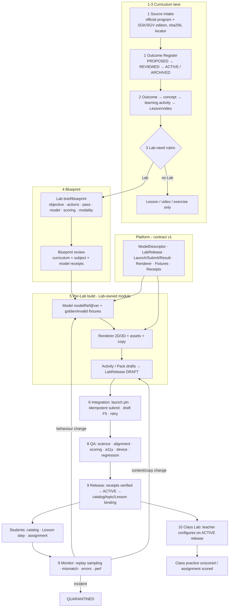
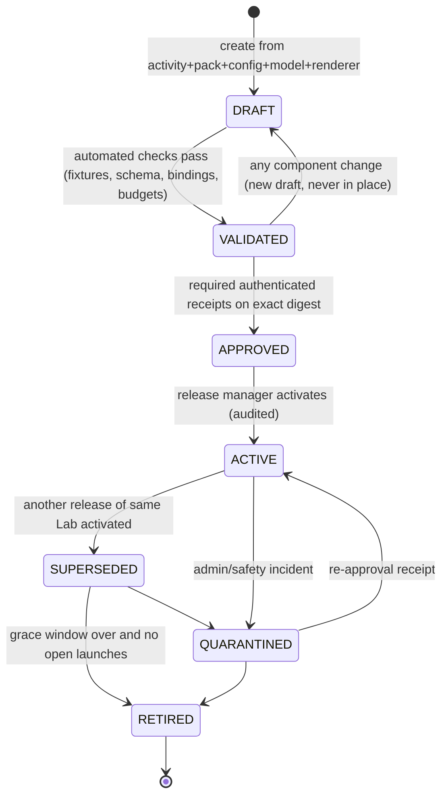

# Lab Pipeline — Stages, Roles and Gates

Two tracks share stages 5–9 (the platform). Stages 1–4 are Foundational-only. Stage 10 is Class Lab, which consumes stage 9 outputs.

## Overview



## LabRelease lifecycle



Historical attempts always keep their `labReleaseId`. Retirement never deletes. Replay availability follows the engine-retention policy (open decision T-6).

## Launch → submit sequence (target)

```mermaid
sequenceDiagram
  participant FE as FE renderer host
  participant BE as BE labs API
  participant DB as DB
  FE->>BE: GET /labs/:labId/launch?context=…
  BE->>DB: active LabRelease for Lab (or ClassLab → its pinned release)
  BE-->>FE: LaunchEnvelope {labReleaseId, rendererKey, stateSchemaVersion, params, copy, limitations}
  FE->>FE: restore draft (user+context+labReleaseId+schema) or initialState
  FE->>FE: advisory preview with same modelRef from @nexalab/sim
  FE->>BE: POST /attempts {labReleaseId, idempotencyKey, labState, context…}
  BE->>DB: lock + load release; check ACTIVE or within grace
  alt release changed beyond grace
    BE-->>FE: 409 LAB_RELEASE_CHANGED (draft kept, relaunch offered)
  else ok
    BE->>BE: validate state constraints → evaluate → score
    BE->>DB: Attempt {labReleaseId, context, execution tuple} + progress projection (one tx)
    BE-->>FE: ResultEnvelope
  end
```

## Stage table

| # | Stage | Input | Output | Responsible | Gate to leave stage |
|---|---|---|---|---|---|
| 1 | Source intake & Outcome Register | Official program document (identity TBD, open decision C-1), SGK/SGV editions with sha256 | Register rows: stable code, statement, grade, strand, source locator(s), origin type, review state, reviewer receipt | Curriculum lead, reviewer | Each row has a source locator and a review state. `ACTIVE` only with an authenticated reviewer receipt. KHTN 9 rows carry `provenanceStatus` |
| 2 | Mapping | Register, taxonomy keys, released Lessons/videos | Outcome → concept → activity → Lesson/video map, recorded per mapping with state | Curriculum lead | Mappings carry their own review state. No mapping inherits approval from its outcome |
| 3 | Lab-need selection | Map + rubric (`foundational-lab-track.md` §Rubric) | Ranked Lab catalog with outcome coverage, modality proposal and model-reuse estimate | PM + curriculum + science lead | Each catalog entry passes the rubric threshold and names the outcomes it serves. Scope is bounded per grade (see §Scope) |
| 4 | Blueprint | Catalog entry | Lab blueprint (template in `foundational-lab-track.md`) | Lab owner | Curriculum, subject and model receipts on the blueprint digest |
| 5 | Build | Blueprint, contract v1 | Lab module: model + descriptor + fixtures (BE), renderer + copy (FE), asset versions | Lab team | All Lab fixtures pass on server and FE preview parity. Contract tests pass. Asset budgets met |
| 6 | Integration | Lab module, platform | LabRelease DRAFT → VALIDATED in staging | Lab team + platform integrator | Integration suite: launch pin, idempotency incl. concurrent duplicate, F5 draft, network retry, activation mid-session, authorization |
| 7 | Versioning | VALIDATED components | Immutable digests, compatibility record (FE renderer min version, schema version) | Platform integrator | No component changes after VALIDATED without a new draft. Compatibility check blocks activation if the deployed FE/BE cannot run it |
| 8 | QA | VALIDATED release | QA report | QA + reviewers | See `foundational-lab-track.md` §QA matrix |
| 9 | Release & maintain | APPROVED release | ACTIVE release, catalog/topic/Lesson bindings, monitoring | Release manager. Admin (quarantine only) | Release endpoint verifies receipts on digests. Monitoring baseline recorded. Rollback = activate previous approved release |
| 10 | Class Lab | ACTIVE Foundational release | Class Lab versions, class practice, scored assignments | Class-owner teacher | See `class-lab-track.md` |

## Scope of the KHTN 8–9 catalog

- **Grade 8 first:** the catalog covers KHTN 8 chapters that have released Structured Lessons. The snapshot count (47) is unverified in this spec.
- **Unit of a Lab is a scientific model, not a Lesson.** Target is roughly 8–12 Foundational Labs for KHTN 8 (P3.1 catalog ranks 10). Each serves several Lessons.
- **Grade 9** entries are recorded as `reuse candidates` on the same model. A KHTN 9 binding becomes eligible only after register rows for KHTN 9 meet the provenance standard (stage 1 gate).
- **Excluded:** outcomes whose evidence is reading/recall only (rubric score 0 on "interaction reveals something static content cannot"), hazardous real procedures without a reviewed virtual-only framing, and models needing medical/individual-physiology claims.

## Parallelism

| Can run in parallel | Must wait |
|---|---|
| Stage 1–3 (curriculum) ‖ contract v1 + platform (P3.2) | Stage 4 receipts wait for real reviewers |
| Stage 5 for ≤2 Labs after P3.5 gate | Stage 6 waits for platform P3.2 gate |
| Renderer work ‖ model work inside one Lab (shared fixtures are the contract) | Stage 9 waits for stage 8 + receipts |
| Class Lab design ‖ pilot build | Class Lab implementation waits for one ACTIVE release (P3.4) |
