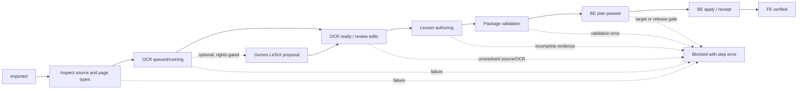
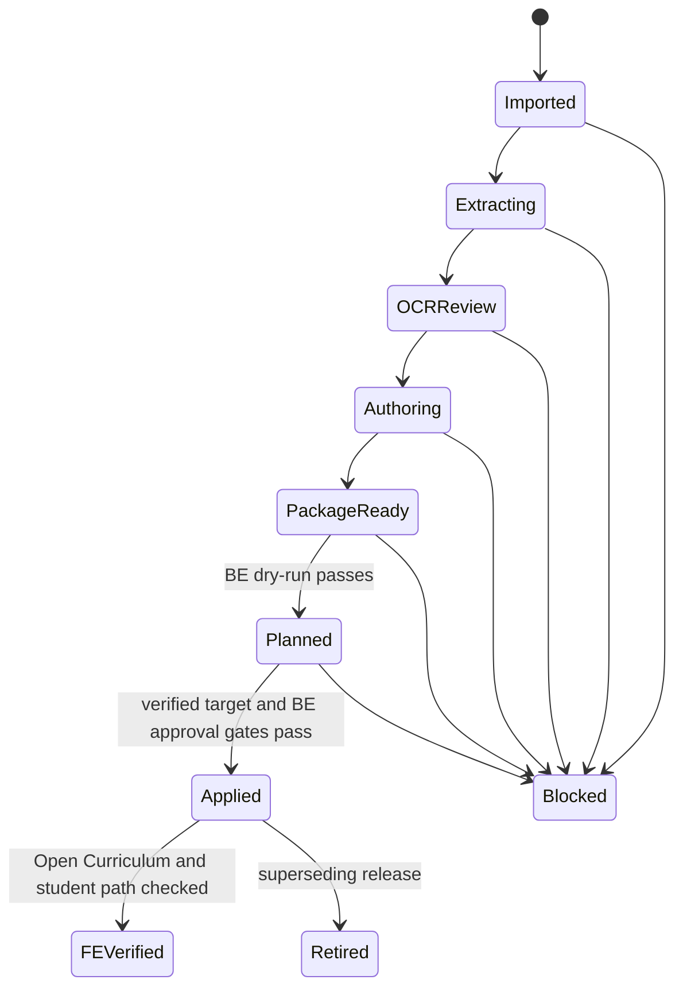

# Sơ đồ kiến trúc

## Ranh giới hệ thống

```mermaid
flowchart LR
    S[PDF và curriculum/source evidence được phép dùng] --> I
    subgraph T[Standalone Content Tool — local workspace]
      I[Import UI + per-book job state]
      E[PyMuPDF + MinerU local]
      R[OCR Review/Edit UI — no reviewer identity]
      G[Optional Gemini LaTeX proposal — rights-gated]
      A[Lesson authoring UI + stable IDs]
      V[Package validation/export]
      P[BE plan/apply CLI]
      I --> E --> R --> A --> V --> P
      R -->|selected block only, when enabled| G -->|proposal, operator decides| R
    end
    P -->|manifest and verified request| B[NexaLab BE]
    B -->|controlled media upload| O[(Cloudflare R2)]
    B -->|validate, persist, release| D[(Supabase PostgreSQL)]
    D --> F[NexaLab FE / Open Curriculum]
    F --> M[@nexalab/sim]
```

## Luồng và trạng thái theo từng sách



Persist stage and artifacts in the local workspace so the operator can resume after closing/reopening the tool. Show page counts or percent only when the OCR process provides reliable progress; otherwise show the current stage and running state. This job state is distinct from student Lesson/course progress.

OCR review saves actions, edits, duration, and source/result hashes without asking for reviewer identity. Formal content/release approval remains a separate NexaLab BE gate. Applying a release does not imply course binding or completed student progress.

## Trạng thái package/release


