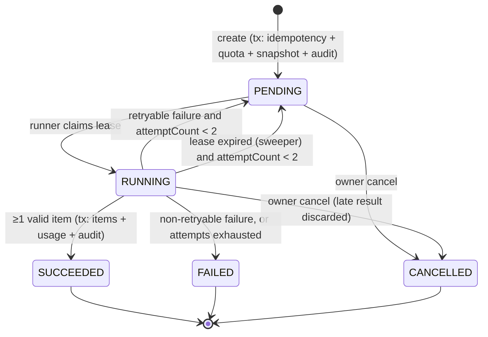

# AI Job Runtime and Failure Modes

Shared by TAI-01 and every later Teacher AI spec. Later purposes add a `purpose` value and an output schema. They do not add a second runner.

## State machine



| From | To | Trigger | Guard |
| --- | --- | --- | --- |
| — | PENDING | `POST /classes/:id/ai-jobs` | owner, class ACTIVE, lesson accessible, provider configured, quota available, idempotency key claimed in same tx |
| PENDING | RUNNING | runner `UPDATE … SET status=RUNNING, leaseUntil=now()+90s, attemptCount=attemptCount+1, startedAt=coalesce(startedAt, now()) WHERE id=? AND status=PENDING` | update count = 1 (otherwise another instance won) |
| RUNNING | SUCCEEDED | validation leaves ≥1 item | `WHERE status=RUNNING AND attemptCount=<claimed>`; on 0 rows the result is discarded (cancelled or reclaimed) |
| RUNNING | PENDING | `PROVIDER_UNAVAILABLE`, `PROVIDER_TIMEOUT`, `OUTPUT_SCHEMA_INVALID`, or expired lease | `attemptCount < 2` |
| RUNNING | FAILED | `OUTPUT_VALIDATION_FAILED`, `LESSON_UNAVAILABLE`, `INTERNAL_ERROR`, or retryable failure with `attemptCount = 2` | conditional on same claimed `attemptCount` |
| PENDING/RUNNING | CANCELLED | owner cancel | terminal states return 409 |

Terminal states never change. `materializedResourceId` is the only field written after `SUCCEEDED`.

## Runner

- In-process worker started by the `ai` module. It polls every 2 s for the oldest `PENDING` job (`ORDER BY createdAt LIMIT 1` per tick per instance) and processes the claimed job with a provider timeout of 60 s, below the 90 s lease.
- Sweeper runs every 30 s and at boot. It handles `RUNNING` with `leaseUntil < now()` by applying the lease-expired transition.
- Each step is a short transaction. **Claim** (tx) → **build prompt from stored snapshot** (no DB reads of live lesson) → **provider call** (no tx) → **parse + validate** (pure function, duplicate corpus read outside the write tx) → **persist** (tx, conditional on claimed attempt).
- Duplicate corpus is the class's non-archived `ClassResource` content read at validation time. A resource created between validation and review is not re-checked. This is an accepted race, covered by the teacher review.
- The runner is disabled with `AI_RUNNER_ENABLED=false` (tests and maintenance). Jobs then stay `PENDING` and are processed when it is enabled again.

## Provider port

```ts
interface AiProvider {
  name: "gemini" | "fake";
  generate(input: { system: string; user: string; maxTokens: number; timeoutMs: number }):
    Promise<{ text: string; inputTokens: number; outputTokens: number; requestId?: string }>;
}
```

- The Gemini adapter uses `GEMINI_API_KEY` and `GEMINI_MODEL`. It requests JSON output (`responseMimeType: application/json` with the `resource-items@1` schema) and reads token counts from the response usage metadata. HTTP 429 (free-tier quota), 5xx and network errors map to `PROVIDER_UNAVAILABLE`. An abort maps to `PROVIDER_TIMEOUT`. A blocked or empty candidate maps to `OUTPUT_SCHEMA_INVALID`. Other 4xx responses map to `INTERNAL_ERROR` (non-retryable).
- Free-tier pacing: each instance processes one job at a time and waits at least `AI_PROVIDER_MIN_INTERVAL_MS` (default 6000) between provider calls. The provider's own limits are read from the Google AI Studio console and are not hard-coded.
- The fake adapter returns fixture JSON chosen by lesson id, and can be forced to emit invalid JSON, a timeout or unsafe content for tests. Boot fails if `AI_PROVIDER=fake` and `APP_ENV=production`.
- The prompt carries the snapshot as a JSON block and the teacher instruction inside explicit delimiters. The system text states that all supplied strings are data and the output must be JSON matching `resource-items@1`.

## Quota

Checked inside the create transaction while holding a per-actor advisory lock (`pg_advisory_xact_lock(hashtext('ai-quota:'||actorId))`), so concurrent creates cannot both pass:

- `count(AiJob where actorId and createdAt > now()-24h and not (status=FAILED and failureCode in provider-side codes))` < `AI_DAILY_JOB_LIMIT` (default 20). Jobs failed by the provider do not consume quota.
- `count(AiJob where actorId and status in (PENDING, RUNNING))` < `AI_CONCURRENT_JOB_LIMIT` (default 2).

## Failure modes

| Failure | Detection | Outcome | Teacher sees |
| --- | --- | --- | --- |
| Provider down / 429 / 5xx | adapter error | retry once, then `FAILED PROVIDER_UNAVAILABLE`; quota not consumed | "Dịch vụ AI tạm thời không khả dụng", retry as new request |
| Provider slow | 60 s abort | as above with `PROVIDER_TIMEOUT` | same |
| API instance dies mid-call | lease expires | sweeper requeues or fails; no duplicate items because persist is conditional on claimed attempt | delay only |
| Non-JSON / wrong shape | Zod parse | retry once, then `FAILED OUTPUT_SCHEMA_INVALID` | failed, retry as new request |
| All items invalid | validation | `FAILED OUTPUT_VALIDATION_FAILED`, dropped reasons stored | reason summary |
| Some items invalid | validation | `SUCCEEDED` with fewer items; `droppedItems` lists reasons | "8/10 câu hợp lệ, 2 câu bị loại: …" |
| Lesson deleted / access lost before run | runner reloads lesson existence only | `FAILED LESSON_UNAVAILABLE` | failed |
| Lesson edited after creation | digest compare on read | job unaffected; `lessonChangedSinceGeneration=true` | warning banner |
| Teacher double-clicks create | idempotency key | replayed 202 | one job |
| Teacher cancels during run | conditional persist finds `CANCELLED` | result discarded, tokens still recorded | cancelled |
| Class archived after success | decisions/materialize check class ACTIVE | 409 `CLASS_ARCHIVED` | blocked |
| Prompt injection in instruction or lesson | delimiters + strict schema + validation + human review | worst case is a bad draft the teacher rejects; cannot reach students or data | — |

## Retention

- Raw provider text is not persisted. Logs record job id, provider request id, status and token counts only, never prompt or output text.
- `inputSnapshot`, `request` and items are kept with the job for audit. They contain lesson text and teacher instruction only, never student data.
- A retention job is out of scope here. The NS-13 retention work should include `AiJob` once it exists.
